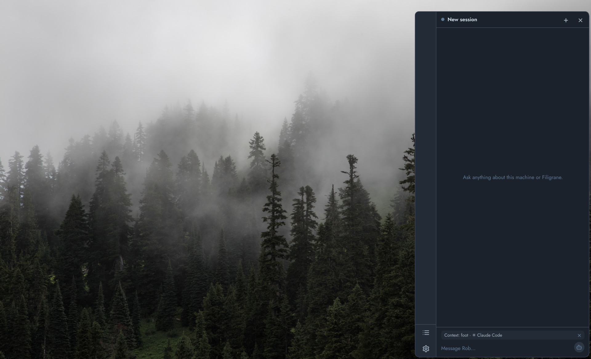
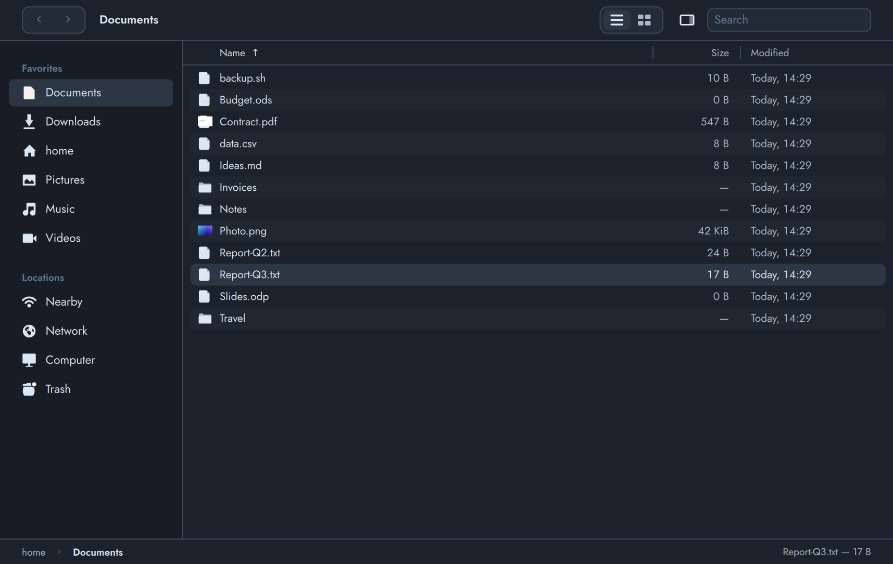
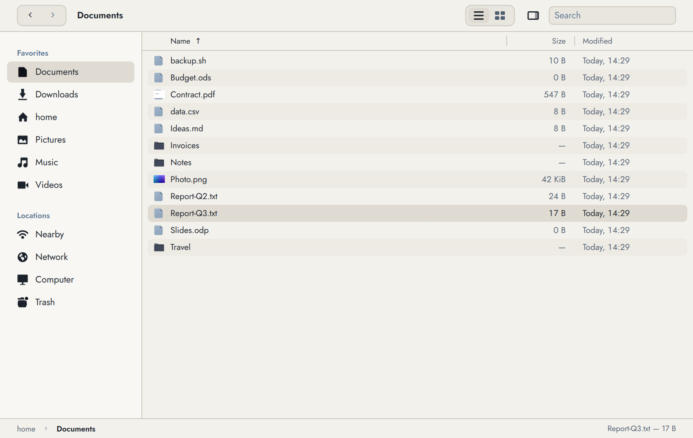

<p align="center">
  <picture>
    <source media="(prefers-color-scheme: dark)" srcset="img/filigrane-empile-sombre.svg">
    
  </picture>
</p>

<p align="center"><em>The OS, discreetly.</em></p>

<p align="center">
  
</p>

**Filigrane** is a light, modern Linux desktop built on [Void Linux](https://voidlinux.org) and the [niri](https://github.com/YaLTeR/niri) compositor, with its own shell and a handful of small native apps. The whole machine is described by one git repository, so any x86-64 PC, virtual machine or Intel Mac can replay it.

## Where it comes from

Filigrane started on an Intel MacBook, with one question: what would an everyday desktop look like if it cost almost nothing? Measured on the same machine, idle, right after boot:

| | Void + niri | macOS (indexing off) |
|---|---|---|
| RAM, system only | ~0.8 GB | ~6.5 GB |
| Power, whole machine on battery | 19.4 W, browser open | ~24 W, no browser |

The memory and the battery saved by the system are memory and battery for what you actually run: a browser, your tools, containers, AI agents. Nothing here is hostile to macOS; its good ideas (a global menu, a written interface guideline, small details that are all consistent) are the ones we borrow.

## The idea

A *filigrane* is a watermark: visible when you look for it, invisible when you read the page. That is the brief for an operating system.

- **It gets out of the way.** A thin veil on top of the machine: translucent layers that stack without hiding anything.
- **Light by construction.** Native Void packages, runit instead of systemd, no resident Electron, JVM or Node. Home-made tools are small Rust binaries. A `budget` tool measures what everything costs, and anything heavy is flagged before it is installed.
- **Modern where it counts.** A scrollable-tiling Wayland compositor, a thin bar you can put on any edge, fine-stroke icons, Jost typography, dark and light modes with an accent, and an interface that follows one written guideline instead of whatever each toolkit does.
- **Agentic.** An AI agent is a first-class citizen, not an add-on (see below).
- **Declarative.** Packages, services, settings and dotfiles live in git. One idempotent `bootstrap.sh` applies them. Personal accounts and tastes sit in their own layer and never fork the distribution.
- **Open.** Everything is public, in English, and the apps work without the distribution.

## The shell

Written in Quickshell (QML) on top of niri, and all in one coherent look:

- **Passerelle**, the bar: built from modules you can choose, reorder, move to another screen edge, and extend with plugins ([Proton Mail](https://github.com/filigrane-os/fili-bar-proton-mail), [WhatsApp](https://github.com/filigrane-os/fili-bar-whatsapp), [VPN](https://github.com/filigrane-os/fili-bar-vpn)…). It also shows the **global menu** of the active application.
- **Quai**, a dock on any of the four edges.
- Launcher, notifications (with the sound of paper and typewriter keys, never a bell), panels, and **Réglages**, the settings window (display, language, power, bar, files).
- Every app window follows the same anatomy, so the whole system feels like one piece.

## The apps

Small, fast, native (Rust and Qt Quick), each with its own icon, an *About* card, a menu exposed to the bar, and a plain config file (`~/.config/filigrane/<app>.toml`) for settings and theme. They run on any Wayland desktop with Qt 6; Filigrane is where they feel at home.

| | App | What it is |
|---|---|---|
|  | **[Casier](https://github.com/filigrane-os/fili-file)** (`fili-file`) | A fast, keyboard-first file manager: list and grid, preview, interactive path, bulk rename, nearby sharing, file portal. |
|  | **Archiveur** (`fili-archive`) | Compress and extract, built into Casier's binary. |
|  | **[Facteur](https://github.com/filigrane-os/fili-mail)** (`fili-mail`) | A mail client with a background daemon that watches every account: Gmail, IMAP/SMTP, JMAP, Microsoft 365. Built on [Omamail](https://github.com/huacnlee/omamail)'s engine. |
|  | **[Aéroport](https://github.com/filigrane-os/fili-term)** (`fili-term`) | The terminal: a Rust session daemon that keeps your sessions alive if a window crashes, and a Qt Quick window that paints only what changed. |
| | **Rob** (`fili-chat`) | The AI drawer, below. |

<p align="center">
  
  
</p>

Each app carries a display name that is the one you see everywhere in the OS (Casier, Facteur, Aéroport); the program name (`fili-file`…) stays in the code and the commands.

## The AI

The agent is part of the system, not a window bolted on top.

- **`Mod+Y`** opens a chat drawer (**Rob**) on the edge of the screen. Sessions are kept while it is hidden, and a session can follow an application.
- **It knows the machine.** The repository's rules (xbps, runit, layers, resource budget) are its working instructions, so it answers "why is my Wi-Fi down?" or "install a PDF reader" the way this system does it, and asks before anything weighty (updates, services, system files).
- **It sees what you were looking at.** `Mod+Y` notes the active application and selection: "rename these files" works.
- **It is reversible.** File changes go through `fili-tx`, one transaction per request, undone with `fili-tx undo`.
- **It is your choice.** Claude Code, Codex, opencode, or local models through Ollama (nothing leaves the machine). No agent at all is a valid setting.

## Principles

1. **Discretion first**: if a feature costs resident memory or attention, it has to earn it.
2. **One guideline**: the interface rules are written down (inspired by classic Mac OS X) and checked by tests.
3. **Everything is a file in git**: if it is not in the repository, it is not part of the machine.
4. **Apps that bring something**: a Filigrane app must do more than the standard tool it replaces, and stay light.
5. **Yours**: personal layer, plugins and settings files, never a fork.

## Repositories

| Repository | Contents |
|---|---|
| [**filigrane**](https://github.com/filigrane-os/filigrane) | The distribution: packages, services, dotfiles, shell, tools, docs, ISO |
| [fili-file](https://github.com/filigrane-os/fili-file) · [fili-mail](https://github.com/filigrane-os/fili-mail) · [fili-term](https://github.com/filigrane-os/fili-term) | Casier, Facteur, Aéroport |
| [niri](https://github.com/filigrane-os/niri) | niri with one patch (display handling on docks) |
| [fili-index](https://github.com/filigrane-os/fili-index) | Index of installable apps, bar plugins and web apps |
| `fili-bar-*` | Bar plugins |

## Try it

On a Void Linux system that is already installed:

```
git clone https://github.com/filigrane-os/filigrane ~/filigrane && cd ~/filigrane
./bootstrap.sh
```

Full guides (install, usage, configuration, the bar, the AI agent) are in the [`docs/`](https://github.com/filigrane-os/filigrane/tree/main/docs) folder. Filigrane is a young project: it is developed on one Intel MacBook (T2), and some paths (bare-metal profile, ISO) are not yet tested end to end.
